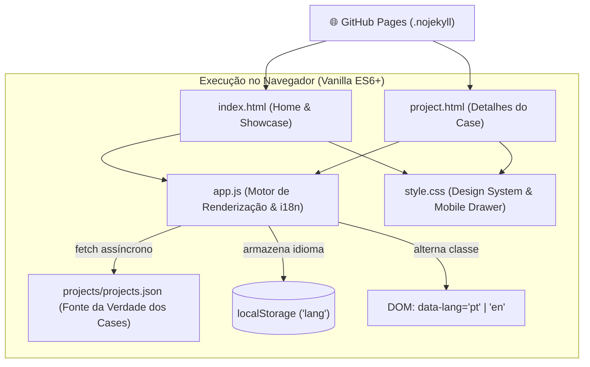

# Portfólio — Luciano Teixeira ⚡

> **Portfólio Institucional & Showcase Técnico**  
> Engenharia de Dados Sênior (GCP, Databricks, dbt, Airflow) & Arquitetura de IA (Sistemas Multiagente, LangGraph, RAG, SLMs locais).  
> **Hospedagem:** GitHub Pages (`.nojekyll`, sem etapa de build).  
> **Stack Core:** HTML5 semântico, CSS3 moderno, JavaScript vanilla (ES6+), JSON desacoplado.

---

## 🏛️ Arquitetura do Sistema

A aplicação é puramente estática, ultra-leve e desacoplada. O catálogo de projetos é mantido em `projects/projects.json` e renderizado reativamente pelo navegador via `fetch` assíncrono.



---

## 👥 Célula Enxuta de Engenharia

O desenvolvimento deste repositório é governado pelas personas e regras de harness definidas em `.antigravity/AGENTS.md`:

| Persona | Domínio | Atribuição Técnica |
| :--- | :--- | :--- |
| **`@frontend-specialist`** | UI/UX & CSS | Estilização com design tokens, responsividade mobile/desktop, microinterações e contraste WCAG. |
| **`@software-engineer`** | JavaScript & DOM | Lógica de renderização de projetos via `projects.json`, rotas `?slug=`, persistência e i18n. |
| **`@qa-test-engineer`** | Validação & QA | Auditoria de sintaxe, validação de JSON, testes de layout e integridade de links. |

---

## 🚀 Execução Local (Padrão Canônico `uv`)

Em conformidade rigorosa com as **Core Rules da Frota (§2.1 e §3.11)**, o **`uv`** é o único gerenciador autorizado para invocar o interpretador Python e ferramentas de apoio. Nunca invoque interpretadores globais (`python` ou `python3`) diretamente.

### Iniciar o servidor HTTP local:
```bash
uv run python -m http.server 8000
```

Após iniciar, acesse no navegador:
```
http://localhost:8000
```

> **Nota:** O servidor HTTP é obrigatório para visualização local porque os projetos são carregados assincronamente via `fetch("projects/projects.json")`, cujo acesso direto por `file://` é bloqueado por políticas de segurança CORS do navegador.

---

## 🧪 Validação Técnica & QA

Antes de qualquer commit, a célula de QA valida a integridade estrutural e de sintaxe:

```bash
# 1. Validar sintaxe do JavaScript
node -c app.js

# 2. Validar integridade sintática do catálogo de projetos
node -e "JSON.parse(require('fs').readFileSync('projects/projects.json'))"

# 3. Validar status do Git e branch de trabalho
git status
```

---

## ➕ Adicionar um Novo Projeto / Case Técnico

1. Abra [projects/_TEMPLATE.json](projects/_TEMPLATE.json) e copie o bloco de exemplo.
2. Insira em [projects/projects.json](projects/projects.json) respeitando a convenção de ordenação (públicos primeiro, privados depois, ambos em ordem alfabética estrita por título).
3. Preencha os campos estruturados:
   - `slug`: identificador único em formato kebab-case (ex: `meu-novo-agente`).
   - `title`: nome técnico do projeto.
   - `summary`: resumo conciso destacando valor de negócio e arquitetura.
   - `stack[]`: array com as principais tecnologias (ex: `["Python", "LangGraph", "FastAPI"]`).
   - `source_url` & `source_type`: link de origem e tipo (`repositório`, `artigo`, `vídeo`).
   - `repo_url`: URL do repositório no GitHub (deixe `""` se for privado).
   - `demo_url`: URL da demo pública online (se houver).
   - `date`: formato `AAAA-MM` ou `AAAA`.
   - `status`: `ativo`, `MVP`, `em uso` ou `lab`.
   - `private`: `true` para exibir o badge de código sob demanda ou `false` para código aberto.
   - `how_to_run`: instruções no padrão `uv` e Docker.
   - `transcript`: (opcional) caminho para markdown de transcrição em `projects/<slug>/transcript.md`.
4. Salve e valide o JSON com o comando de QA antes de comitar.

---

## 📱 Recursos de UI & SEO

- **Mobile First:** Menu hambúrguer acessível com drawer animado em resoluções inferiores a 820px.
- **Microinterações:** Sombras calibradas em camadas, elevação no hover e indicador pulsante de disponibilidade profissional no Hero.
- **Social Sharing & Open Graph:** Previews ricos automáticos configurados com imagem em 1200x630 para LinkedIn, WhatsApp e Twitter Cards.
- **Rich Snippets (Schema.org):** JSON-LD estruturado de `Person` indexando credenciais e perfis profissionais.
- **Internacionalização (i18n):** Alternador fluido Português / English com persistência automática no `localStorage`.
